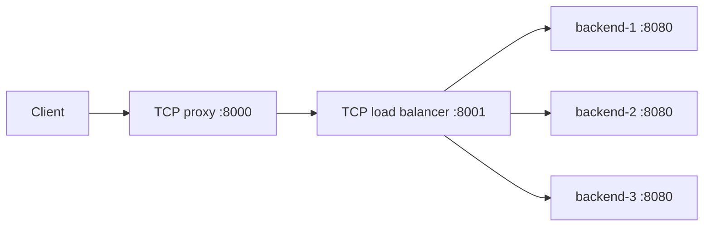

# Python TCP Load Balancer

An educational TCP load balancer built with Python's standard library. It assigns
new connections to backends using round-robin routing and forwards bytes in both
directions. A separate TCP proxy and a minimal HTTP server make the behavior easy
to observe in a five-container Docker Compose demo.

The project explores socket programming, TCP stream framing, thread synchronization,
timeouts, and resource cleanup. It uses the operating system's TCP implementation
and has **no runtime dependencies outside the standard library**.

## Features

- Round-robin selection once per TCP connection, protected by a lock.
- Bidirectional forwarding of arbitrary bytes, including binary data.
- Half-close support: one side can finish sending and still receive a response.
- Connection, idle, and write timeouts, plus controlled SIGINT/SIGTERM shutdown.
- A demo HTTP server with bounded request parsing and UTF-8 body handling.
- Unit tests and integration tests using real loopback sockets and subprocesses.

## Architecture



The diagram shows container ports. Only `127.0.0.1:8000` is published to the host.
The extra proxy demonstrates composing components; the load balancer can also
accept connections directly when run locally.

| Component | Responsibility |
| --- | --- |
| [`TCPServer`](src/app/tcp/server.py) | Accepts connections, starts a worker per client, and manages shutdown. |
| [`ProxyServer`](src/app/proxy/server.py) | Forwards streams using `select` and bounded socket operations. |
| [`LoadBalancerServer`](src/app/load_balancer/server.py) | Selects a backend, then delegates forwarding to the proxy implementation. |
| [`HTTPServer`](src/app/http/server.py) | Parses one request, dispatches a route, and sends one response. |

The selected backend stays fixed for the lifetime of a connection. The proxy and
load balancer do not inspect HTTP or route individual HTTP requests.

## Quick start with Docker Compose

**Requirements:** a running Docker Engine/Desktop, Docker Compose v2 or newer,
`curl`, and a free local port 8000. No local Python installation is needed for this
option. The shell examples below target macOS/Linux.

From the repository root:

```bash
docker compose up --build -d
docker compose ps
```

Allow the Python processes to start before sending requests. Compose dependency
ordering does not guarantee application readiness. If a request fails immediately
after startup, inspect `docker compose logs` and retry once the services are listening.

Send six separate connections:

```bash
for i in 1 2 3 4 5 6; do
  curl --max-time 3 -fsS http://127.0.0.1:8000/api/status
  printf '\n'
done
```

On a fresh start with no other clients, the `backend_id` values repeat in order:
`backend-1`, `backend-2`, `backend-3`. All three containers listen on port 8080;
the identifier distinguishes them.

Try a UTF-8 echo:

```bash
curl --max-time 3 -i -H 'content-type: text/plain; charset=utf-8' \
  --data-binary 'Hello 🌍' http://127.0.0.1:8000/api/echo
```

The response body is `Hello 🌍`, with `Content-Length: 10` and `Connection: close`.
The length counts UTF-8 bytes, not Python string characters.

| Method and path | Response |
| --- | --- |
| `GET /api/status` | JSON containing status, version, backend identity, and a message. |
| `GET /api/users` | A JSON object containing a list of mock users. |
| `POST /api/echo` | The submitted UTF-8 body and its Content-Type, or a text/plain UTF-8 default. |

Unknown routes return 404. Stop and remove the demo when finished:

```bash
docker compose down --timeout 8
```

## Run locally

**Requirements:** Python 3.13+, uv, and free ports 8000, 8001, 8081, 8082, 8083.
The project selects Python 3.13 through `.python-version`. The initial environment
setup requires access to PyPI; the running application needs no external services.

```bash
uv sync --locked
```

Run each command in a separate terminal from the repository root, starting with
the backends:

```bash
BACKEND_ID=backend-1 PYTHONPATH=src uv run --frozen python -m app.run_http_server 8081
BACKEND_ID=backend-2 PYTHONPATH=src uv run --frozen python -m app.run_http_server 8082
BACKEND_ID=backend-3 PYTHONPATH=src uv run --frozen python -m app.run_http_server 8083
PYTHONPATH=src uv run --frozen python -m app.run_load_balancer
PYTHONPATH=src uv run --frozen python -m app.run_proxy_server
```

Use the same curl examples. Local listeners bind to loopback by default; the load
balancer is also available directly at `http://127.0.0.1:8001/api/status`.
Use Ctrl+C in each terminal to stop the processes.

## Tests and code quality

Run the same environment setup and checks as GitHub Actions:

```bash
uv sync --locked
uv run --frozen ruff check
uv run --frozen ruff format --check
uv run --frozen ty check
uv run --frozen pytest -W error
```

Unit tests cover HTTP framing and validation, response serialization, routing,
backend configuration, round-robin selection, and error handling. Integration
tests verify real forwarding, binary payloads, both half-close directions,
backend rotation, idle expiry, and shutdown with active connections.

Integration tests use loopback and system-assigned ports, explicit readiness
signals, bounded waits, and cleanup checks. They require permission to open local
sockets, but do not require Docker or internet access.

Optional local commands:

```bash
uv run --frozen pytest -m 'not integration'
uv run --frozen pytest -m integration
uv run --frozen ruff format
git diff --check
```

## Configuration

| Setting | Default | Purpose |
| --- | --- | --- |
| `HOST` | `127.0.0.1` | Listener address; Compose uses `0.0.0.0` inside containers. |
| HTTP positional port | `8080` | Backend listener port. |
| `BACKEND_ID` | `backend-<port>` | Identity returned by `/api/status`. |
| `BACKEND_SERVERS` | `127.0.0.1:8081,127.0.0.1:8082,127.0.0.1:8083` | Comma-separated IPv4/hostname and decimal port pairs for the demo load balancer. |
| `TARGET_HOST`, `TARGET_PORT` | `127.0.0.1`, `8001` | Destination for the demo proxy. |

The `LoadBalancerServer` constructor defaults to two backends at 8081/8082;
the demo entry point explicitly supplies three. Configuration is validated and
copied into a tuple at construction.

Limits are constructor keyword arguments rather than environment settings:

| Component / argument | Default | Meaning |
| --- | --- | --- |
| HTTP `max_header_bytes` | 16 KiB | Request line, headers, and terminating CRLF separator. |
| HTTP `max_body_bytes` | 1 MiB | Declared body size in bytes. |
| HTTP `request_timeout` | 10 s | Total request receive deadline; progress does not reset it. |
| HTTP / proxy `write_timeout` | 5 s | Socket write timeout. |
| Proxy / load balancer `connect_timeout` | 3 s | Backend TCP connection timeout. |
| Proxy / load balancer `idle_timeout` | 30 s | Time without traffic in either direction. |
| TCP `shutdown_timeout` | 5 s | Budget for joining workers and the serving thread. |

`TCPServer.BUFFER_SIZE` is 1024 bytes. `BACKLOG` is 5 queued connections;
it does not limit the number of active workers.

## Scope and limitations

This is an educational implementation rather than a production traffic proxy.

- **Concurrency:** one thread per client, with no cap on active clients. `select`
  waits for readable sockets; it does not make `sendall` non-blocking. A slow write
  can delay forwarding in the opposite direction until it completes or times out.
- **Routing:** no backend health checks, retries, or failover. If the selected
  backend is unavailable, that connection closes without an HTTP 502 response.
- **HTTP:** ASCII request heads and UTF-8 bodies; HTTP/1.0 and HTTP/1.1 request
  lines; one request/response per connection with `Connection: close`. Routes
  match the method and full target exactly, including any query string.
- **Framing:** missing Content-Length means no body. Invalid or duplicate lengths,
  invalid UTF-8, and any Transfer-Encoding return 400. Extra bytes are discarded;
  premature EOF never dispatches a partial request. Other repeated headers use
  their last value. Size limits return 413/431, receive timeouts 408, and handler
  exceptions 500, when the connection still permits a response.
- **Unsupported features:** persistent connections, pipelining, chunked encoding,
  `Expect: 100-continue`, full HTTP method semantics, TLS, authentication, and IPv6
  listeners.
- **Shutdown:** system DNS resolution is outside the socket connection timeout.
  Python cannot forcibly cancel an arbitrary blocking handler; a worker exceeding
  the shutdown join budget produces a warning. Demo handlers do no blocking work.

See [design notes](docs/design.md) for stream handling, socket ownership, timeout
semantics, and design questions.

## License

Licensed under the [MIT License](LICENSE).
