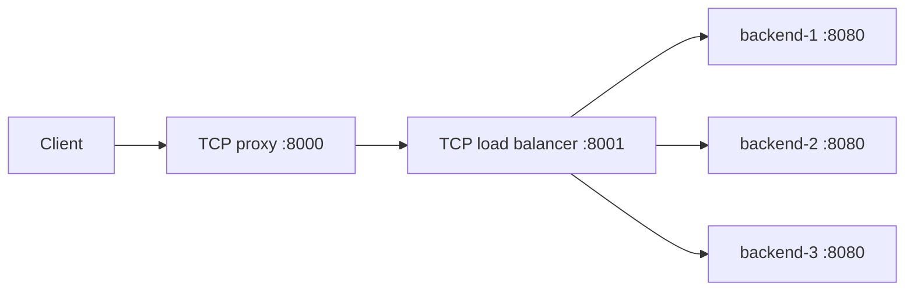

# Python TCP Load Balancer

Educational TCP load balancer in Python with round-robin routing, a TCP proxy, and a minimal HTTP server.

This small project demonstrates TCP sockets, stream framing, bidirectional forwarding,
thread synchronization, resource cleanup, and unit/integration testing. Runtime code
uses only the Python standard library. It uses the operating system's TCP implementation.



The diagram shows Compose ports. Each new TCP connection selects one backend.
The extra proxy demonstrates composing components; the load balancer can also
accept client connections directly.

## Quick start with Docker Compose

Requirements: Docker Engine/Desktop running, Docker Compose v2 or newer, and curl.
From the project root:

```bash
docker compose up --build -d
docker compose ps
```

Only the proxy is published, at `127.0.0.1:8000`. Allow the Python processes to
start before sending requests; Compose dependency ordering does not guarantee readiness.

Send separate connections to observe `backend-1`, `backend-2`, `backend-3` repeating
when no other clients are connected:

```bash
for i in 1 2 3 4 5 6; do
  curl --max-time 3 -fsS http://127.0.0.1:8000/api/status
  printf '\n'
done

curl --max-time 3 -i -H 'content-type: text/plain; charset=utf-8' \
  --data-binary 'Hello 🌍' http://127.0.0.1:8000/api/echo

curl --max-time 3 -fsS http://127.0.0.1:8000/api/users
```

The echo response contains `Content-Length: 10`, `Connection: close`, and `Hello 🌍`.
`/api/status` reports `status`, `version`, `backend_id`, and a message.
`/api/users` returns the original mock users. Unknown routes return 404.

Stop and remove the demo, including its network:

```bash
docker compose down --timeout 8
```

## Run locally

Requirements: Python 3.13 or newer (the project selects 3.13 through `.python-version`),
uv, and free ports 8000, 8001, 8081, 8082, 8083. Installing the locked development
environment requires access to PyPI; no external services are needed at runtime.
The following commands use a POSIX shell (macOS/Linux):

```bash
uv sync --locked
```

Run each command in its own terminal, from the project root. Start the backends first:

```bash
BACKEND_ID=backend-1 PYTHONPATH=src uv run --frozen python -m app.run_http_server 8081
BACKEND_ID=backend-2 PYTHONPATH=src uv run --frozen python -m app.run_http_server 8082
BACKEND_ID=backend-3 PYTHONPATH=src uv run --frozen python -m app.run_http_server 8083
PYTHONPATH=src uv run --frozen python -m app.run_load_balancer
PYTHONPATH=src uv run --frozen python -m app.run_proxy_server
```

Use the same curl commands. All local listeners bind to loopback by default.
Use Ctrl+C in each terminal to stop. The entry points handle SIGINT and SIGTERM,
closing active connections and collecting workers. You can reach the load balancer
at `http://127.0.0.1:8001/api/status` without the extra proxy.

## Checks

CI runs the same locked environment and checks:

```bash
uv sync --locked
uv run --frozen ruff check
uv run --frozen ruff format --check
uv run --frozen ty check
uv run --frozen pytest -W error
git diff --check
```

Optional focused runs and formatting:

```bash
uv run --frozen pytest -m 'not integration'
uv run --frozen pytest -m integration
uv run --frozen ruff format
```

Integration tests use real loopback sockets and system-assigned ports, explicit
readiness signals, bounded waits, and cleanup checks. They also check process shutdown.
They need permission to open local sockets, and do not require Docker or internet.

## Configuration

| Setting | Default | Purpose |
| --- | --- | --- |
| `HOST` | `127.0.0.1` | Listener address for all entry points; Compose sets `0.0.0.0` inside containers |
| HTTP positional port | `8080` | Backend listener port |
| `BACKEND_ID` | `backend-<port>` | Identity reported by `/api/status` |
| `BACKEND_SERVERS` | `127.0.0.1:8081,127.0.0.1:8082,127.0.0.1:8083` | Comma-separated IPv4/hostname and decimal port pairs for the demo load balancer |
| `TARGET_HOST`, `TARGET_PORT` | `127.0.0.1`, `8001` | Demo proxy destination |

The reusable `LoadBalancerServer` constructor defaults to two backends at 8081/8082;
the demo entry point explicitly supplies three. Backend configuration is validated
and copied into a tuple at construction.

Limits are constructor keyword arguments, rather than environment settings:

| Component / argument | Default | Meaning |
| --- | --- | --- |
| HTTP `max_header_bytes` | 16 KiB | Request line, headers, and terminating CRLF separator |
| HTTP `max_body_bytes` | 1 MiB | Declared body size in bytes |
| HTTP `request_timeout` | 10 s | One deadline for receiving the entire request; progress does not reset it |
| HTTP / proxy `write_timeout` | 5 s | Socket write timeout |
| Proxy / load balancer `connect_timeout` | 3 s | Backend TCP connection timeout |
| Proxy / load balancer `idle_timeout` | 30 s | Time without traffic in either direction |
| TCP `shutdown_timeout` | 5 s | Shared budget for joining workers and the serving thread |

`TCPServer.BUFFER_SIZE` is 1024 bytes. `BACKLOG` is 5 queued connections;
it does not limit the number of active workers.

## Decisions and limits

- One worker thread per client connection. The proxy uses `select` to wait for
  readable sockets, then bounded socket operations. It is not a fully non-blocking
  I/O implementation: `sendall` can hold a worker until its write timeout.
- Round-robin runs once per TCP connection, with only the selection/cursor update
  under a lock. There are no routing health checks, retries, or failover. If the
  selected backend is unavailable, that connection closes without an HTTP 502.
- TCP proxying preserves arbitrary bytes, including binary data. The demo HTTP
  server accepts ASCII request heads and UTF-8 text bodies, with case-insensitive
  header names stored as lowercase keys.
- HTTP/1.0 and HTTP/1.1 request lines with an origin-form target (`/path`) are
  accepted. Routes match the method and full target exactly, including any query
  string. The demo supports the GET/POST endpoints above; it does not implement
  the full semantics of every HTTP method.
- Exactly one HTTP request/response per connection, always `Connection: close`.
  No keep-alive, pipelining, chunked encoding, or `Expect: 100-continue` handshake.
  Any `Transfer-Encoding`, including a combination with `Content-Length`, returns 400.
- Missing `Content-Length` means an empty body. Invalid or duplicate lengths and
  invalid UTF-8 return 400; bytes beyond the declared body are discarded. Other
  repeated headers use their last value. Premature EOF never dispatches a partial request.
- HTTP errors use 400 for malformed input, 408 for receive timeout, 413 for body
  size, 431 for header size, and 500 for handler exceptions. A disconnected client
  may prevent delivery of the error response.
- No TLS, authentication, IPv6 listeners, admission control, or production hardening.
  Concurrent clients are not capped. A slow destination can delay the reverse
  stream during a write. System hostname resolution is outside the socket connection
  timeout; Python cannot forcibly cancel a blocking custom handler. Shutdown logs
  a warning if a worker exceeds its join budget. Demo handlers perform no blocking work.

See [design notes](docs/design.md) for data flow and questions to explore while studying.
